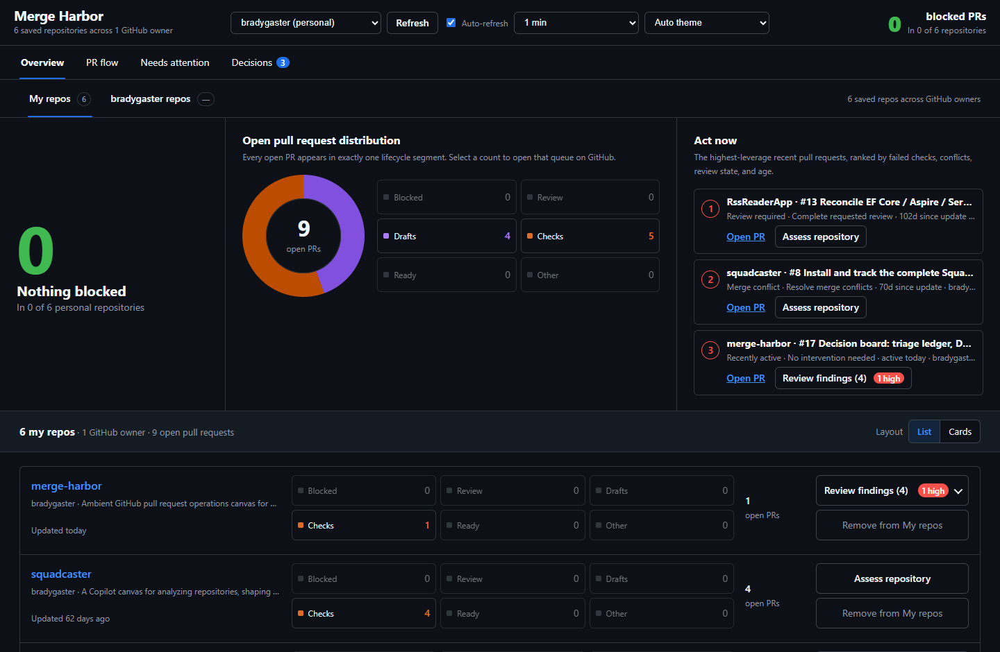
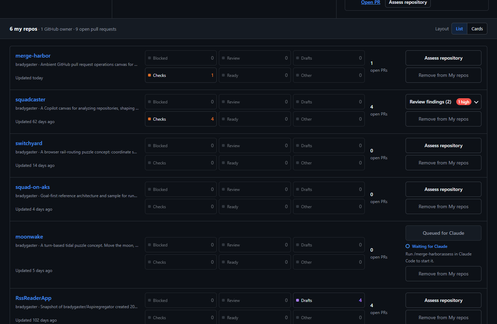
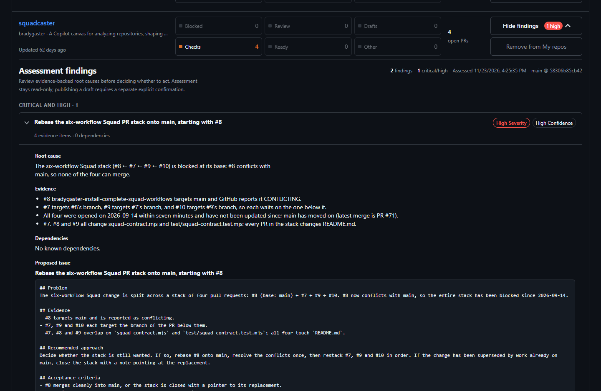
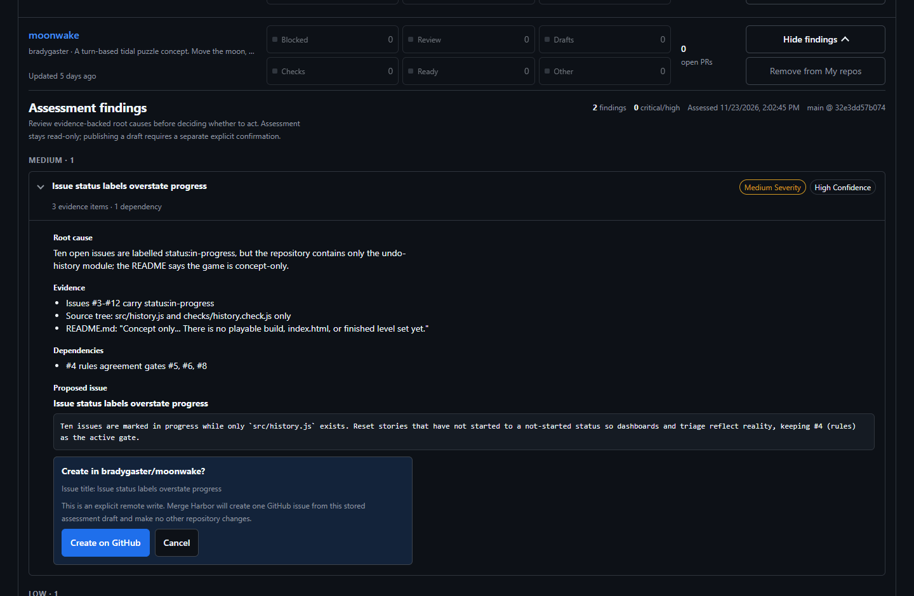
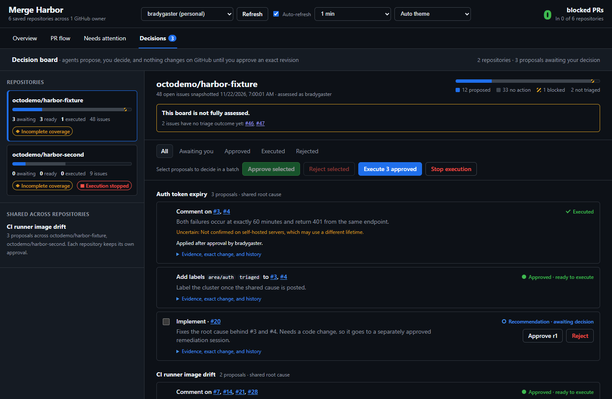

# Merge Harbor

Merge Harbor is a canvas for monitoring pull request flow across organizations, building a personal cross-organization repository watchlist, requesting conservative repository assessments, and approving exact issue actions on a decision board.

It runs in two agent hosts from one shared runtime:

| Host | Install | How assessments start |
| --- | --- | --- |
| **GitHub Copilot** app | This repository, as a Copilot extension ([install](#install-from-the-custom-marketplace)) | Copilot starts them as soon as you select **Assess repository**. |
| **Claude Code** | [`bradygaster/merge-harbor-claude`](https://github.com/bradygaster/merge-harbor-claude), as a Claude Code plugin | The canvas queues them; run `/merge-harbor:assess` and Claude claims and runs them. |



*Copilot: Overview combines GitHub lifecycle telemetry, direct action links, personal repositories, and organization search.*



*Claude Code: the same canvas, served by the plugin's MCP server. squadcaster's assessment was claimed and run by Claude; moonwake is queued until you run `/merge-harbor:assess`.*

Screenshots show the canvas page itself, without the surrounding app window.

## Prerequisites

- GitHub Copilot desktop app with custom plugins and extension canvases enabled
- Read access to [`bradygaster/merge-harbor`](https://github.com/bradygaster/merge-harbor)
- [GitHub CLI](https://cli.github.com/) installed and authenticated as the account whose repositories and organizations you want to view

Verify the local GitHub connection before installing:

```powershell
gh --version
gh auth status
```

If your organization uses SAML SSO, authorize the authenticated account for that organization before opening Merge Harbor.

## Install from the custom marketplace

Copy this marketplace repository URL:

```text
https://github.com/bradygaster/merge-harbor
```

1. Open **Customize** in the GitHub Copilot app.
2. Open the marketplace settings beside the marketplace selector.
3. Add `https://github.com/bradygaster/merge-harbor` as a marketplace repository.
4. Return to **Browse** and select the **merge-harbor** marketplace.
5. Find **merge-harbor**, then install and enable it.
6. Reload extensions if prompted. Otherwise, start a new session after installation.
7. Ask Copilot to **Open Merge Harbor**.

This is a custom marketplace, not a globally featured listing. It is visible only after adding the repository and only to users who can read it. The installed plugin is managed under **Customize** > **Installed**; its canvas may not receive a separate entry in a curated **Canvas** list.

### Direct extension installation

If you do not want to add the marketplace, choose **Install extension from GitHub**, select **User** scope, and paste:

```text
https://github.com/bradygaster/merge-harbor/tree/main/extension
```

Then start a new session and ask Copilot to **Open Merge Harbor**.

## Update, reload, disable, or remove

- **Update:** Open **Customize** > **Installed** > **merge-harbor** and use **Update** when available. If the app does not expose an update action, uninstall and reinstall from the same marketplace.
- **Reload:** Use the app's extension reload action when prompted or available. If the canvas list remains stale, start a new session or restart the app.
- **Disable or re-enable:** Use the controls for **merge-harbor** under **Customize** > **Installed**, then reload extensions.
- **Uninstall:** Remove **merge-harbor** from **Customize** > **Installed**.
- **Remove the marketplace:** After uninstalling, remove `bradygaster/merge-harbor` from marketplace settings if you no longer want it listed.

The lifecycle actions exposed by the app can vary by build. Do not edit the installed package by hand as a substitute for marketplace installation or update.

## Use Merge Harbor

### 1. Choose an owner

Use the owner selector to load your authenticated personal account or any visible GitHub organization. Organization search queries the selected owner's repository inventory as you type.

Merge Harbor can access only repositories visible to the account reported by `gh auth status`.

### 2. Build My repos

Add repositories from different owners to **My repos** for one persistent personal view. The list and selected owner are stored locally under:

```text
$COPILOT_HOME/extensions/merge-harbor/artifacts/preferences.json
```

Auto-refresh cadence is stored by the canvas page. Updating or reinstalling normally preserves these settings unless the app removes the extension artifact directory or browser storage.

### 3. Move between operational views

- **Overview:** Scan repository-level Blocked, Review, Drafts, Checks, Ready, and Other queues. These categories are mutually exclusive, so each open pull request appears once.
- **PR flow:** See the organization-wide flow of open pull requests through the same lifecycle.
- **Needs attention:** Review the highest-leverage recent pull requests and open the matching GitHub action directly.
- **Decisions:** Review what an agent proposes for each repository's open issues, approve or reject exact revisions, and execute only what you approved. See [Decide on issue triage](#7-decide-on-issue-triage).
- **List / Cards:** Change repository density without changing assessment behavior.
- **Refresh / Auto-refresh:** Refresh immediately or select the automatic refresh cadence.

### 4. Assess a repository safely

Select **Assess repository** from a repository or Needs attention entry.

An assessment creates a durable local mission and asks the agent (in Copilot, the current session; in Claude Code, `/merge-harbor:assess`) to coordinate bounded specialists against an isolated disposable clone or worktree at the exact default-branch commit. By default, assessment is static and read-only:

- It does not modify the user's existing checkout.
- It does not run repository tests, builds, scripts, hooks, package installs, package-manager commands, or other repository code.
- It does not push, create issues or pull requests, change labels, or perform any remote write.
- Relevant repository content is processed through the agent host's model service (GitHub Copilot or Claude); assessment is not offline.
- Any code execution requires separate explicit approval and a secrets-free, network-restricted sandbox. A clone or worktree alone is filesystem separation, not execution isolation.

Mission state persists across extension reloads. Interrupted work is recovered into a retryable state instead of blocking future assessments.

### 5. Review progressive findings

When assessment completes, **Review findings** expands a panel attached to that repository. Findings remain grouped by severity and collapsed by default so you can scan:

- proposed issue title
- root-cause summary
- severity and confidence
- evidence and dependency counts

Expand a finding to review its root cause, evidence, dependencies, and complete proposed issue draft. Assessments appear only in their repository's row: while one is starting or running, or if it fails, the row shows its status under the assessment button. To review a repository that is not in the current list, select its owner, search for it, or add it to My repos.



*Claude Code: a finding from Claude's read-only assessment of squadcaster, with its evidence and the issue it proposes.*

### 6. Create an issue explicitly



*Copilot: issue creation stays inside the finding and requires a second explicit confirmation.*

Issue publication is separate from the read-only assessment:

1. Expand a completed finding.
2. Select **Create issue**.
3. Verify the repository and issue title in the inline confirmation.
4. Select **Create on GitHub**, or select **Cancel** to return to the untouched draft.
5. While GitHub processes the request, both controls are disabled.
6. On success, use **Open issue #N**. On failure, the inline error remains retryable and the draft is preserved.

The browser submits only the durable mission and finding reference. The local extension re-reads the completed validated mission and derives the repository, title, and body from stored assessment data. A deterministic hidden marker and persisted issue identity make retries idempotent and reconcile publication after interruption.

This explicit action creates only one plain GitHub issue. It does not add labels, assignees, projects, comments, or any other remote mutation.

### 7. Decide on issue triage



*Decisions, shown with development sample boards: coverage per repository, blockers shared across repositories, and proposals that state the exact write.*

Ask the agent to triage a repository (in Claude Code, `/merge-harbor:triage owner/name`). Merge Harbor fetches the complete open-issue inventory itself, and the agent reports proposals grouped by root cause, each with one exact action and its evidence. **Approval to assess is not approval to act:**

- Triage never changes GitHub. Proposals wait for you in **Decisions**.
- You approve or reject an exact revision. If the agent revises a proposal later, your earlier approval no longer applies and it asks again.
- Batch decisions show the frozen list you are confirming.
- **Execute** lists every write first, re-checks that each issue is unchanged and that you are still the signed-in account, and writes only approved actions. Retries never write twice.

Every inventory issue must end up with a proposal, a no-action result, or a blocked result, and the coverage bar shows any that are still untriaged.

## Security and data handling

- The embedded web server binds only to `127.0.0.1`.
- GitHub metadata and issue publication use the locally authenticated `gh` CLI.
- The extension requires no Merge Harbor backend.
- Selected-owner and My repos preferences remain local.
- Assessment mission state, disposable clones or worktrees, and approved experimental file changes remain local.
- Relevant repository content used by an assessment is processed through the GitHub Copilot service.
- Assessment remains read-only by default; issue publication requires the separate two-step action described above.

## Troubleshooting

### Marketplace or plugin is missing

- Confirm you can open [`bradygaster/merge-harbor`](https://github.com/bradygaster/merge-harbor).
- Confirm the marketplace URL is exactly `https://github.com/bradygaster/merge-harbor`.
- Look under **Customize** > **Browse** for installation and **Customize** > **Installed** for enablement. Do not rely on a separate Canvas listing.

### Merge Harbor will not open after installation

- Confirm **merge-harbor** is enabled under **Customize** > **Installed**.
- Reload extensions if the app exposes that action.
- Start a new session or restart the app, then ask Copilot to **Open Merge Harbor**.

### GitHub data will not load or an organization is absent

Run:

```powershell
gh auth status
gh api user --jq .login
```

Confirm the returned account has access to the repository or organization and has completed any required SSO authorization. Then use **Refresh** in Merge Harbor.

### Data looks stale

- Select **Refresh** for an immediate reload.
- Confirm Auto-refresh is enabled and select the intended cadence.
- Confirm the expected owner or **My repos** tab is active.

### Assessment cannot start or complete

- Confirm the authenticated account can read the repository and its default branch.
- Retry an interrupted or failed mission from the repository action.
- Assessment does not execute repository code by default; requests that require execution need separate approval and an appropriate isolated environment.

### Issue creation fails

- Confirm `gh auth status` reports the intended account.
- Confirm that account can create issues in the target repository and that issues are enabled.
- Retry from the inline error. The deterministic marker and stored publication record protect against duplicate creation after an interrupted response.

### Preferences appear reset

Check whether this file still exists under the same app profile:

```text
$COPILOT_HOME/extensions/merge-harbor/artifacts/preferences.json
```

Uninstall behavior is app-owned. Back up this file before uninstalling if preserving My repos is important.

## Package layout and compatibility

- Plugin release version: `0.3.0`
- Extension manifest format version: `1`
- Plugin layout: Agent Plugins 1.0 `plugin.json`, `.github/plugin/marketplace.json`, and `com.github.copilot/extensions/merge-harbor/`
- Canvas implementation: `extension/`
- Shared runtime: `extension/harbor-runtime.mjs` and the modules it imports are host-neutral. `extension/extension.mjs` is the Copilot host; [`merge-harbor-claude`](https://github.com/bradygaster/merge-harbor-claude) syncs the same files as its Claude Code host.

The marketplace catalog installs the repository-root Agent Plugin described by `plugin.json`. Its Copilot extension contribution forwards to the existing `extension/` implementation rather than maintaining a second runtime.

Change the shared runtime here, then run `node scripts/sync-runtime.mjs` in `merge-harbor-claude` to bring the Claude plugin up to date.

## Development

Run the dependency-free validation:

```powershell
node scripts/validate.mjs
node scripts/validate.test.mjs
node scripts/assessment.test.mjs
node scripts/disclosure.test.mjs
node scripts/telemetry.test.mjs
node scripts/decision.test.mjs
node scripts/decision-service.test.mjs
```

To preview the canvas in a browser with live data from your `gh` account, run `node scripts/preview.mjs` and open `http://127.0.0.1:4317/`. Add `--seed-boards` for development-only decision boards. State is kept in `.preview/`. A tool bridge on the next port lets you report assessment or triage results as Copilot would.

For local extension development, copy `extension/` to `$COPILOT_HOME/extensions/merge-harbor/`, reload extensions, and open the `merge-harbor` canvas. For plugin packaging changes, add this repository as a local or GitHub-hosted marketplace and install `merge-harbor@merge-harbor`.

Reference documentation:

- [Creating and sharing a plugin marketplace on GitHub](https://docs.github.com/en/copilot/how-tos/copilot-on-github/customize-copilot/create-and-share-plugin-marketplaces)
- [Plugin and marketplace reference](https://docs.github.com/en/copilot/reference/plugin-and-marketplace-reference)
- [Customizing the GitHub Copilot app](https://docs.github.com/en/copilot/how-tos/github-copilot-app/customize-github-copilot-app)

## License

MIT
